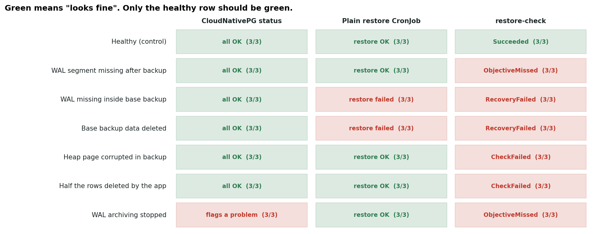
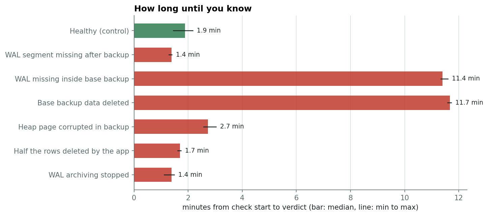
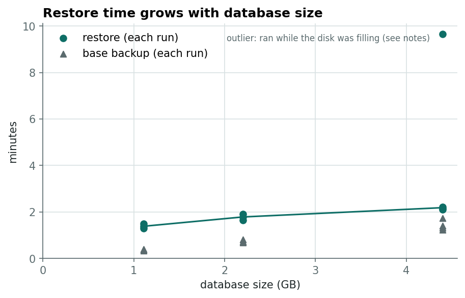
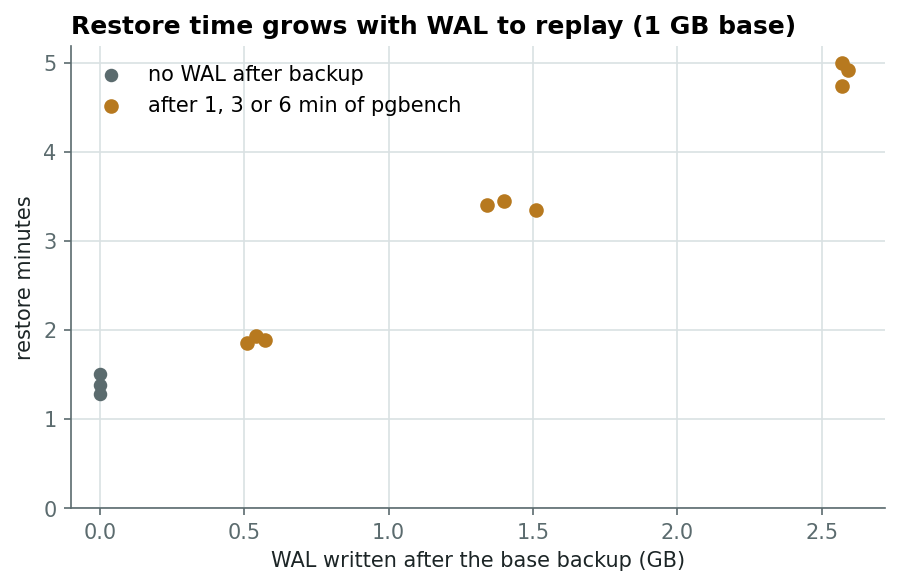
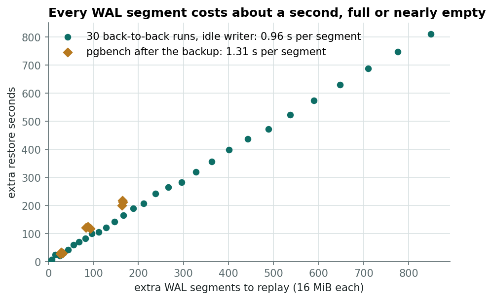
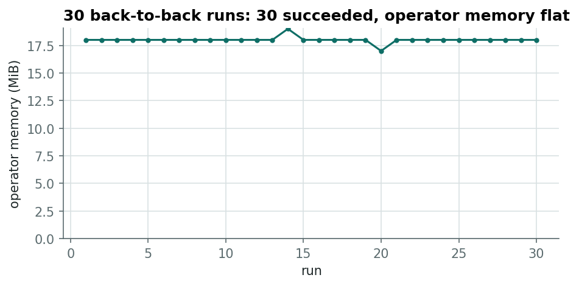

# Benchmark: what restore-check catches, and what a restore costs

**Short version.** Six broken backups, three ways of asking "can I restore?":

| | Broken backups caught (of 6) | Time to a failing verdict |
|---|---|---|
| CloudNativePG `Backup` status and `ContinuousArchiving` condition | **1** | immediate, but only for stopped archiving |
| A plain restore CronJob (restore, wait for Ready, delete) | **2** | 20 min (its full wait) |
| restore-check (restore, then amcheck, a SQL check, data age) | **6** | 1.4 to 11.7 min (medians) |



- In 5 of the 6 cases CloudNativePG reported every backup `completed` and archiving healthy.
- A restore that only waits for the cluster to become Ready passes 4 of the 6: a missing WAL segment (recovery quietly stops early), a corrupted page, half the rows gone, and stopped archiving. It only fails when the restore cannot start at all.
- restore-check caught all six, with a reason that points at the problem: `RecoveryFailed`, `CheckFailed` (naming the check and the Postgres error), or `ObjectiveMissed` (how old the newest restored data is).
- Every one of the 93 runs (21 detection, 21 baseline, 30 back-to-back, 21 sizing) cleaned up after itself: no clusters, jobs, pods or volumes left behind.
- Restore time is mostly WAL segments: about one second per 16 MiB segment, full or nearly empty. A database that switches WAL often and takes base backups rarely restores slowly even when it is small.

## The question

A CloudNativePG `Backup` reaching `completed` means the base backup was uploaded. It does not mean you can restore from it. This benchmark breaks backups in the ways they break in real life, then compares three answers to "can I restore?":

- **CloudNativePG's own status:** the `Backup` phase and the cluster's `ContinuousArchiving` condition.
- **A plain restore CronJob:** the do-it-yourself test many teams run. It creates a recovery cluster from the latest backup, waits up to 20 minutes for it to be Ready, passes if it is, and deletes it ([`manifests/baseline-cronjob.yaml`](manifests/baseline-cronjob.yaml)).
- **restore-check's verdict:** an actual restore into a temporary cluster, followed by checks (amcheck over every page, a SQL query, data age).

It also measures how long a restore takes as the database and the WAL to replay grow, and whether restore-check itself is safe to leave running (30 back-to-back runs).

## Results

### 1. What each approach reported

3 runs per scenario. Full rows: [`results/detection.csv`](results/detection.csv) and [`results/baseline.csv`](results/baseline.csv).

| Scenario | CloudNativePG status | Plain restore CronJob | restore-check | restore-check's message (first run) |
|---|---|---|---|---|
| Healthy (control) | OK | pass | `Succeeded` | |
| WAL segment missing after backup | OK | **pass** | `ObjectiveMissed` | newest restored data is 1m42s old, objective 1m0s |
| WAL missing inside base backup | OK | fail (20 min) | `RecoveryFailed` | full-recovery job failed (BackoffLimitExceeded), with the `kubectl logs` command to inspect it |
| Base backup data deleted | OK | fail (20 min) | `RecoveryFailed` | same |
| Heap page corrupted in backup | OK | **pass** | `CheckFailed` | amcheck: invalid page in block 3 of relation base/16385/16392 (SQLSTATE XX001) |
| Half the rows deleted by the app | OK | **pass** | `CheckFailed` | sql/expected-rows: assertion returned false |
| WAL archiving stopped | **flags it** (`ContinuousArchiving=False`) | **pass** | `ObjectiveMissed` | newest restored data is 8m12s old, objective 1m0s |

Two of these deserve a second look:

- **WAL segment missing after backup.** The restore does not fail. Recovery replays up to the gap, stops, and the cluster comes up Ready with everything after the gap missing. Only a check on how fresh the restored data is notices.
- **Half the rows deleted.** The backup is faithful; the data was already wrong. No restore test catches this without a check that knows what the data should look like. Here it is a `count(*)`; in production it would be a query on something you know must be true.

### 2. How long until you know



| Scenario | restore-check verdict, median (min to max) |
|---|---|
| Healthy | 113 s (87 to 130) |
| WAL segment missing after backup | 83 s (77 to 84) |
| WAL missing inside base backup | 684 s (680 to 696) |
| Base backup data deleted | 700 s (695 to 703) |
| Heap page corrupted | 164 s (154 to 182) |
| Half the rows deleted | 102 s (97 to 104) |
| Archiving stopped | 83 s (67 to 89) |

The two `RecoveryFailed` cases are slow because CloudNativePG retries the recovery job several times before giving up; restore-check reports as soon as the job is marked failed. The CronJob has no such signal: it waits for Ready until its own timeout (20 minutes here) and fails then.

### 3. What a restore costs



| Database | Base backup | Restore, median |
|---|---|---|
| 1.1 GB | 23 s | 83 s |
| 2.2 GB | 44 s | 107 s |
| 4.4 GB | 82 s | 129 s |

Doubling the database added about 20 seconds to the restore. One 4.4 GB run took 579 s; it ran while the VM's disk was filling (see "Validation"), so it is shown in the chart, labelled, and left out of the median. A clean fourth run took 133 s.



Same 1.1 GB database, with pgbench running for 1, 3 or 6 minutes after the backup:

| WAL after the backup | Restore, median of 3 |
|---|---|
| none | 83 s |
| 0.54 GB | 113 s |
| 1.40 GB | 204 s |
| 2.57 GB | 295 s |

A GB of WAL cost more restore time than a GB of base backup. The reason is in the next chart.



Restore time follows the number of WAL segments, not their size. Recovery fetches segments one at a time, and each one costs about a second whether it is full of changes (pgbench, 1.31 s each) or nearly empty (the idle writer below, which forces a switch every 10 s: 0.96 s each). With the default settings used here:

- **Forced switches add up.** `archive_timeout` closes a segment whenever anything was written, even a few bytes. At CloudNativePG's default of 5 minutes, a database with a small constant trickle of writes (a heartbeat, a monitoring insert) produces up to 288 segments a day: roughly 5 minutes of restore time for every day since the last base backup.
- **Base backup frequency sets the ceiling.** Restore time grows with the segments since the last base backup, so a weekly backup on a busy database means replaying up to a week of segments.

Absolute numbers here are low because the object store is in the same cluster; with S3 over a network each fetch costs more. plugin-barman-cloud can fetch WAL in parallel (`wal.maxParallel`); this benchmark used the default and did not measure that setting.

### 4. Is it safe to leave running

30 runs back to back on one `RestoreCheck`, each started with the run-now annotation as soon as the previous one finished.

- **30 of 30 succeeded.** No leftovers after any run.
- **The operator stayed at 17 to 19 MiB** and under 25 millicores of CPU throughout.
- **Restore time rose from 75 s to 886 s.** Not a leak: all 30 runs restored the same base backup while the writer kept switching WAL every 10 s, so each run had more segments to replay (20 at run 1, 869 at run 30). That is the source of the segment chart above. Taking a new base backup resets it.



Full rows: [`results/reliability.csv`](results/reliability.csv).

## Method

### Environment

| | |
|---|---|
| Kubernetes | K3s v1.35.10, single node |
| Node | Ubuntu 24.04 VM, 4 vCPU, 8 GiB RAM, virtio disk on an NVMe SSD; host CPU Intel i7-1265U |
| Storage | local-path provisioner |
| CloudNativePG | 1.30.1, PostgreSQL 18.6, data checksums on (the CloudNativePG default) |
| Backups | plugin-barman-cloud v0.16.0, WAL compressed with gzip, base backups uncompressed |
| Object store | RustFS (S3 API) in the same cluster |
| restore-check | v0.2.0 (`ghcr.io/shanurwan/cnpg-restore-check:0.2.0`) |

Everything is installed by [`setup.sh`](setup.sh); versions are pinned in [`versions.env`](versions.env).

### Each detection run

1. Create a fresh namespace, a fresh bucket prefix and a one-instance source cluster.
2. Insert 100,000 rows into `orders`, then `VACUUM (FREEZE)` and `CHECKPOINT` (see "Validation" for why).
3. Start a writer: a row in `heartbeat` every 2 s and a WAL switch every 10 s.
4. Take a base backup and wait for `completed`.
5. Apply one fault (below).
6. Create a `RestoreCheck`; its first run starts immediately. Wait for the verdict. For the baseline, start the CronJob's job by hand instead (`kubectl create job --from=cronjob/restore-test`) and wait for it to finish.
7. Record both views, everything the run left behind, and timings; delete the namespace.

Checks configured on every run: `amcheck` with heap verification, a SQL check `count(*) = 100000` on `orders`, freshness from `max(ts)` in `heartbeat` with a data-age objective of 60 s.

### Failure modes

| Scenario | What is done | Real-world cause |
|---|---|---|
| Healthy (control) | nothing | |
| WAL segment missing after backup | one WAL segment written after the backup is deleted from the bucket | lifecycle rule, manual cleanup, partial bucket copy |
| WAL missing inside base backup | the first WAL segment the base backup needs (`begin_wal` in `backup.info`) is deleted | retention that removes WAL still needed by a backup |
| Base backup data deleted | the base backup's data files are deleted; `backup.info` stays | object deletion, failed replication of the bucket |
| Heap page corrupted in backup | 64 bytes of line pointers on page 3 of `orders` are overwritten inside `data.tar` | storage or transfer corruption |
| Half the rows deleted by the app | before the backup, half of `orders` is deleted | an application bug; the backup is faithful to bad data |
| WAL archiving stopped | the archive credentials are replaced with wrong ones; writes continue for 2 minutes | rotated or expired credentials, revoked IAM role |

### Validation

Every fault records proof that it was applied: the deleted object key and a `HEAD` showing it is gone, the tar member and its MD5 before and after the corruption, the number of rows deleted, or the archiver's failure count. These are in each run's `fault` field in `results/raw/detection/`.

Things found while validating the harness:

- **Corruption can be repaired by WAL replay.** In a first version, the table was not frozen before the backup. Autovacuum then rewrote its pages after the backup started, each rewrite put a full-page image in WAL, and recovery overwrote the damaged page with a clean copy: the restore passed every check ([`results/trials/heap-corruption-unfrozen-trial.json`](results/trials/heap-corruption-unfrozen-trial.json)). With the table frozen and checkpointed first, the same damage survives recovery and is caught ([`results/trials/heap-corruption-frozen-trial.json`](results/trials/heap-corruption-frozen-trial.json)). Corruption in a backup only matters for pages that no WAL record rewrites afterwards.
- **barman-cloud refuses a used prefix.** Reusing a bucket prefix that already holds WAL makes the archiver fail with "Expected empty archive", and a new backup waits for WAL forever. Every run here uses a fresh prefix.
- **A WAL file and a backup label share a name.** The first version of the "WAL missing inside base backup" fault matched by prefix and deleted the `.backup` label file instead of the WAL segment; the restore still passed. The proof recorded with the fault (which key was deleted) showed it. Those runs are kept in `results/trials/label-deleted-instead-of-wal-*` and the scenario was rerun with an exact match.
- **CloudNativePG names a ServiceAccount and Role after each cluster.** The baseline job first used a ServiceAccount called `restore-test`, the same name as its recovery cluster. CloudNativePG replaced that Role with its own, and the job lost permission to delete the cluster. If you write your own restore CronJob, do not give its ServiceAccount the cluster's name.
- **Clean the bucket.** Early runs never deleted their bucket prefix. The disk filled, Kubernetes evicted the object store, and the runs in progress failed. Every run now deletes its prefix at the end; the failed runs were discarded and rerun.

## Reproduce

```sh
git clone https://github.com/shanurwan/cnpg-restore-check && cd cnpg-restore-check/benchmark
./setup.sh                                  # cert-manager, CloudNativePG, barman-cloud, restore-check, S3
REPS=3 PAR=3 ./run-detection.sh                  # 7 scenarios x 3 runs, restore-check -> results/raw/detection/
CHECKER=cronjob REPS=3 PAR=3 ./run-detection.sh  # the same with the plain CronJob   -> results/raw/baseline/
./size.sh 70 1                                   # restore time at pgbench scale 70 (1.1 GB), run 1; also 140, 280
./size.sh 70 1 180                               # the same with 180 s of pgbench after the backup
./reliability.sh 30                              # 30 back-to-back runs              -> results/raw/reliability/
python3 analysis/collect.py                 # -> results/*.csv
python3 analysis/plot.py                    # -> charts/*.png (needs matplotlib)
```

One scenario on its own: `./detect.sh wal-gap 1`. Each run takes 2 to 15 minutes; the full set took about 10 hours of wall-clock time on the machine above.

## Files

| Path | What it is |
|---|---|
| `setup.sh`, `versions.env` | environment install, pinned versions |
| `detect.sh`, `run-detection.sh` | one detection run, and the batch |
| `size.sh`, `reliability.sh` | restore time by size and WAL, back-to-back runs |
| `lib/` | shared shell helpers, bucket operations (`s3ops.py`), result merger |
| `manifests/` | source cluster, object stores, backup, RestoreCheck, the baseline CronJob, S3 helper pod |
| `results/raw/` | one JSON record per run: both views, the fault proof, leftovers, timings |
| `results/*.csv` | the tables in this document |
| `charts/` | the charts in this document |
| `analysis/` | `collect.py` (raw to CSV), `plot.py` (CSV to charts) |

## Limits

- **One node, one machine.** The object store sits in the same cluster, so restores are faster than they would be against S3 over a network. Compare shapes, not seconds.
- **Small databases, one setting each.** 1 to 4.4 GB, default WAL fetch settings. Restore time for a production-sized database needs a run on real infrastructure.
- **Faults are injected, not found.** Each one stands for a real cause (see the table above), but real failures can be messier: partial uploads, throttling, a wrong storage class.
- **The CronJob baseline is one reasonable script, not every possible one.** Adding SQL checks to it would catch more. By then you are writing your own restore-check.
- **The data checks are only as good as what you ask.** restore-check caught the deleted rows because the test knew how many rows to expect.
