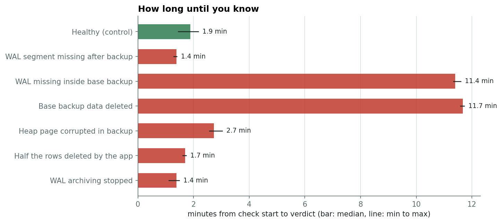
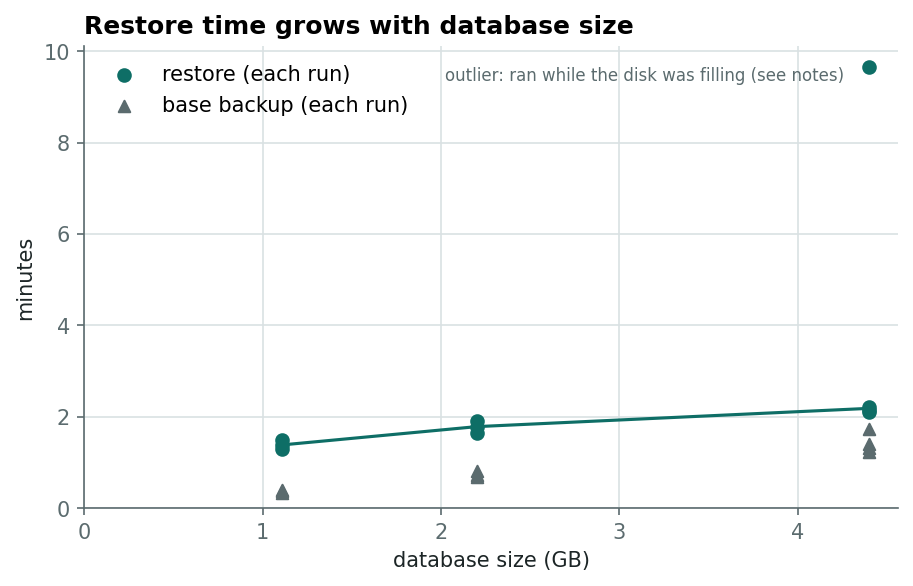
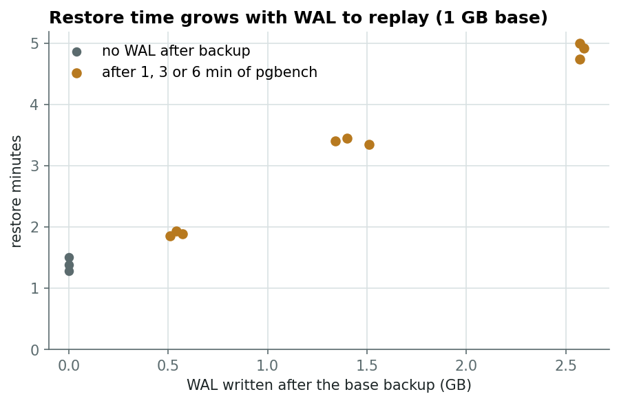
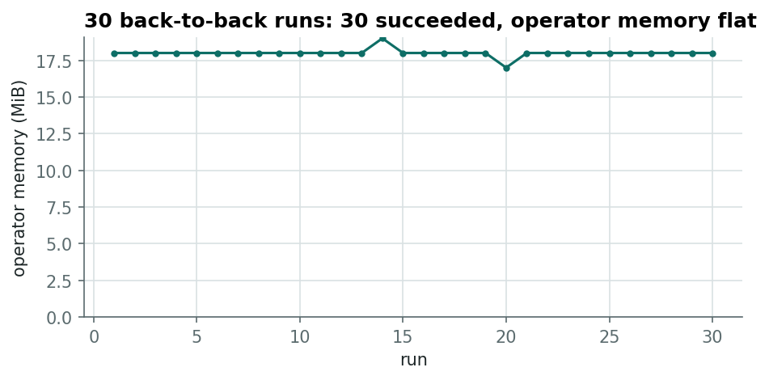
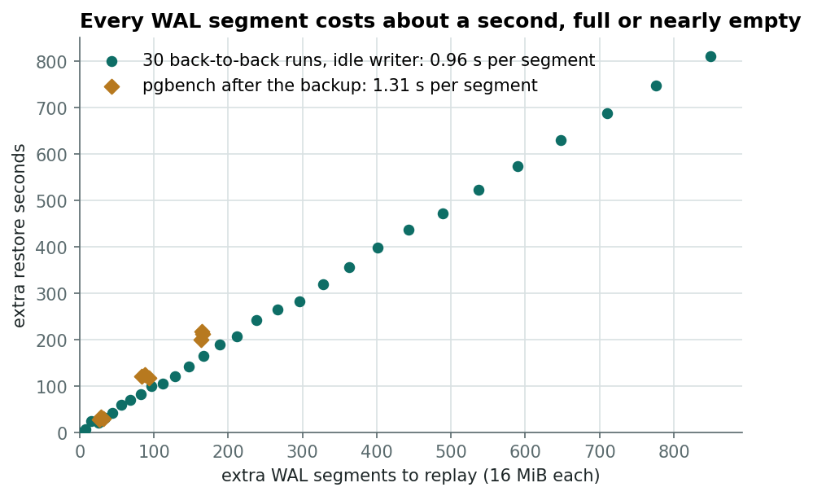

CloudNativePG `Backup completed` tells you the base backup was uploaded. To know whether it's restorable, we deployed a CronJob to automate restore tests on a schedule so we could get alerted upon failure. An independent due diligence we did ourselves caught a failed restore that our CronJob missed alerting us about, so I built a Kubernetes controller for CNPG that runs restore checks on a schedule, tests the restore and verifies the data.

I conducted a benchmark study on restore reliability by breaking backups on purpose, six different ways, and asked three things whether I could still restore:

1. **CloudNativePG's own status**: the `Backup` phase and the cluster's `ContinuousArchiving` condition.
2. **A plain restore CronJob**: create a recovery cluster from the latest backup, wait up to 20 minutes for it to become Ready, pass if it does, delete it. This is the restore test many teams write first, and it is the kind of test that missed our failure.
3. **[restore-check](https://github.com/shanurwan/cnpg-restore-check)**, the controller: it restores into a temporary cluster, then runs amcheck over every page, a SQL check you choose, and a check on how old the newest restored data is.

## At a glance

| | |
|---|---|
| **Question** | When a Postgres backup on Kubernetes says `completed`, can you restore it, and what do you get back? |
| **Approach** | 6 realistic failure modes injected into real backups, each proven applied, each run 3 times in isolation, judged by 3 different checks |
| **Scale** | 93 runs, about 10 hours, every run on a fresh namespace, bucket prefix and source cluster |
| **Outcome** | CloudNativePG status caught 1 of 6. The restore CronJob caught 2 of 6. restore-check caught 6 of 6, each with a reason that points at the cause |
| **Biggest surprise** | Restore time is set by the number of WAL segments to replay, about 1 second each, not by database size |

Everything (harness, raw results per run, charts) is in the repo's [benchmark folder](https://github.com/shanurwan/cnpg-restore-check/tree/main/benchmark), with pinned versions and the commands to reproduce it.

## The problem

A backup system answers "did the upload finish?". A business asks "if we lose this database at 3 a.m., how long until it is back, and how much data do we lose?". Those are recovery time (RTO) and recovery point (RPO), and neither can be read from a backup status. They can only be measured by restoring.

Most teams know this, so they add a restore test. The common shape is a CronJob that creates a recovery cluster, waits for it to become Ready, and deletes it. That test answers a third question: "does Postgres start?". The failure our own check caught lived in the gap between that question and the one the business asks.

So the benchmark is built around one idea: **a restore test is only as good as the failures it can tell apart.** To measure that, I needed failures that are realistic, provably applied, and repeatable.

## The failure modes

Each fault stands for something that happens in production. Each one was applied after a real base backup reached `completed`, except the application bug, which by its nature happens before.

| Failure mode | How it is injected | What causes it in real life |
|---|---|---|
| **Healthy (control)** | nothing | |
| **WAL segment missing after the backup** | one WAL segment written after the backup is deleted from the bucket | a lifecycle rule, a manual cleanup, a partial bucket copy or migration |
| **WAL missing inside the base backup** | the first WAL segment the backup needs (`begin_wal` in its `backup.info`) is deleted | a retention policy that removes WAL a backup still depends on |
| **Base backup data deleted** | the backup's data files are deleted, `backup.info` is left in place | object deletion, a failed bucket replication |
| **Heap page corrupted** | 64 bytes of line pointers on page 3 of the `orders` table are overwritten inside the backup's `data.tar` | storage or transfer corruption, bit rot in cold storage |
| **Half the rows deleted by the application** | half of `orders` is deleted before the backup | an application bug or bad migration; the backup faithfully preserves bad data |
| **WAL archiving stopped** | the archive credentials are replaced with wrong ones; writes continue for 2 minutes | rotated or expired credentials, a revoked IAM role |

The list is deliberately not only "the backup is broken". Two of these failures leave a backup that is technically perfect. That is the point: what the business cares about is the data you get back, not the files.

## The validation harness

A benchmark that injects faults has an obvious weakness: if a fault silently fails to apply, a "pass" looks exactly like a correct result. Most of the work went into making that impossible to miss.

### One run, start to finish

1. **Isolate.** Create a fresh namespace, a fresh bucket prefix and a one-instance source cluster. Nothing is shared between runs, so one run's leftovers cannot change the next one's result.
2. **Load known data.** Insert 100,000 rows into `orders`, then `VACUUM (FREEZE)` and `CHECKPOINT`. (Why the freeze matters is one of the findings below.)
3. **Start a writer.** A row in a `heartbeat` table every 2 seconds and a forced WAL switch every 10 seconds. This gives the restored database a "newest row" to measure data age against, and produces a steady stream of WAL like a real, lightly used database.
4. **Back up and wait for proof, not status.** Take a base backup and wait for `completed`. Before any fault touches WAL, switch WAL and wait until `pg_stat_archiver` reports that segment archived, so "the segment I am about to delete" is really in the bucket.
5. **Apply one fault and record proof of it.** (Below.)
6. **Judge.** Create a `RestoreCheck` and wait for its verdict. For the CronJob baseline, trigger the job by hand from the CronJob and wait for it to finish. Record CloudNativePG's own status at the same moment.
7. **Audit and clean up.** List every cluster, job, pod and volume the run left behind, delete the bucket prefix, delete the namespace, and wait for it to be gone before the next run reuses the name.

Every run writes one JSON record: all three verdicts, the fault proof, the leftovers, and timings. A small Python step turns those records into the CSV tables, and a second one draws the charts. Nothing in the write-up is typed by hand from a terminal.

### Proof that each fault was applied

| Fault | Recorded proof |
|---|---|
| Deleted WAL or data | the exact object key deleted, and a `HEAD` request showing it is gone |
| Page corruption | the tar member changed, with its MD5 before and after |
| Rows deleted | the number of rows deleted |
| Archiving stopped | `pg_stat_archiver.failed_count` after 2 minutes of writes |

The checks were the same on every run: amcheck with heap verification, a SQL assertion `count(*) = 100000` on `orders`, and freshness from `max(ts)` on `heartbeat` against a 60-second data-age objective.

### What the harness caught in my own work

This part matters more than any single number, because each item is a way the benchmark would have quietly lied.

- **A fault that did not apply.** The first version of "WAL missing inside the base backup" matched the segment by prefix. A WAL segment and the backup's `.backup` label file share that prefix, and it deleted the label instead. The restore passed. The recorded key showed why. Those runs are kept in the repo as trials, and the scenario was rerun with an exact match.
- **A fault that WAL replay undid.** The first corruption runs passed every check: the damaged page was clean after the restore. Details below.
- **A harness that broke the cluster it was measuring.** Early runs never deleted their bucket prefix. The disk filled, Kubernetes evicted the object store, and the runs in progress failed. Those runs were thrown away, per-run bucket cleanup was added, and the batch was rerun. One sizing run that overlapped the disk filling is shown in the chart, labelled, and left out of the median.
- **An object store that refuses reuse.** barman-cloud fails with "Expected empty archive" on a prefix that already holds WAL, and the next backup waits forever. Hence a fresh prefix per run.
- **A naming collision with the operator.** The baseline CronJob's ServiceAccount and Role were first named `restore-test`, the same name as its recovery cluster. CloudNativePG creates a ServiceAccount and Role named after each cluster and replaced mine. The job lost permission to delete the cluster it had just created. Renaming fixed it.
- **A namespace still terminating.** A rerun could start while the previous namespace with the same name was still being deleted, and fail for that reason alone. Setup now waits for it to be gone.

## Results

### 1. What each check reported

| Failure mode | CloudNativePG status | Restore CronJob | restore-check | restore-check's message |
|---|---|---|---|---|
| Healthy (control) | OK | pass | `Succeeded` | |
| WAL segment missing after backup | OK | **pass** | `ObjectiveMissed` | newest restored data is 1m42s old, objective 1m0s |
| WAL missing inside base backup | OK | fail | `RecoveryFailed` | recovery job failed (BackoffLimitExceeded), with the `kubectl logs` command to inspect it |
| Base backup data deleted | OK | fail | `RecoveryFailed` | same |
| Heap page corrupted | OK | **pass** | `CheckFailed` | amcheck: invalid page in block 3 of relation base/16385/16392 (SQLSTATE XX001) |
| Half the rows deleted | OK | **pass** | `CheckFailed` | sql/expected-rows: assertion returned false |
| WAL archiving stopped | **flags it** | **pass** | `ObjectiveMissed` | newest restored data is 8m12s old, objective 1m0s |

All three runs of every scenario agreed.

In five of the six cases CloudNativePG reported every backup `completed` and archiving healthy. That is not a bug in CloudNativePG. Its status describes the upload, and the upload was fine. What happened to the files afterwards, or what was in them, is outside what it can see.

The CronJob is the more important column, because it is what teams build once they know status is not enough. It failed only when the restore could not start at all. It passed the four cases where Postgres started and the data was wrong:

- **WAL segment missing after the backup.** I expected this to fail. It does not. Recovery replays WAL up to the gap, stops without an error, and the cluster comes up Ready with everything after the gap missing. Only a check on how fresh the restored data is notices. In RPO terms, this is a restore that silently gives you a worse recovery point than you think you have.
- **Corrupted page.** Postgres does not read every page on startup, so it started fine. amcheck reads every page and found it.
- **Half the rows deleted.** The backup is faithful; the data was already wrong. No restore test catches this unless it knows what the data should look like. Here that is a `count(*)`; in production it would be a query about something the business knows must be true, such as "yesterday's orders exist".
- **Archiving stopped.** CloudNativePG did flag this one. The CronJob restored the last backup and whatever WAL made it out, and passed. restore-check measured the result in the unit that matters: the restored data was 8 minutes stale.

### 2. How long until you know

| Failure mode | restore-check verdict, median (min to max) | Restore CronJob |
|---|---|---|
| Healthy | 113 s (87 to 130) | pass |
| WAL segment missing after backup | 83 s (77 to 84) | pass |
| WAL missing inside base backup | 684 s (680 to 696) | fail at 20 min, its timeout |
| Base backup data deleted | 700 s (695 to 703) | fail at 20 min, its timeout |
| Heap page corrupted | 164 s (154 to 182) | pass |
| Half the rows deleted | 102 s (97 to 104) | pass |
| Archiving stopped | 83 s (67 to 89) | pass |

The two unrecoverable cases are slow because CloudNativePG retries the recovery job several times before giving up. restore-check reports as soon as the job is marked failed, and its message includes the command to read the job's logs. A CronJob that waits for Ready has no such signal: it waits for its timeout. If your restore test has a generous timeout, every broken backup costs you that full timeout before anyone is paged.

### 3. What a restore costs

| Database | Base backup | Restore, median of 3 |
|---|---|---|
| 1.1 GB | 23 s | 83 s |
| 2.2 GB | 44 s | 107 s |
| 4.4 GB | 82 s | 129 s |

Doubling the database added about 20 seconds to the restore. WAL told a different story. Same 1.1 GB database, with pgbench running for 1, 3 or 6 minutes after the backup:

| WAL after the backup | Restore, median of 3 |
|---|---|
| none | 83 s |
| 0.54 GB | 113 s |
| 1.40 GB | 204 s |
| 2.57 GB | 295 s |

Going from 1.1 GB to 4.4 GB of base backup added 46 seconds. Adding 2.57 GB of WAL added 212 seconds. A gigabyte of WAL costs several times more restore time than a gigabyte of data. The next finding explains why.

### 4. Is it safe to leave running

A restore checker that runs every night is itself production software. I ran 30 restores back to back on one `RestoreCheck`, each started as soon as the previous one finished.

- **30 of 30 succeeded**, with nothing left behind after any run.
- **The operator stayed at 17 to 19 MiB** of memory and under 25 millicores of CPU throughout.
- **Restore time rose from 75 seconds to 886 seconds.** That looked like a leak. It was not, and it led to the most useful finding of the study.

Across all 93 runs, the leftover audit found no cluster, job, pod or volume left behind.

## Three things I did not expect

### 1. WAL replay can repair the corruption you injected

My first version of the corruption test passed every check. The corrupted page was clean after the restore.

The reason: autovacuum touched the table after the backup started. The first change to a page after a checkpoint writes a full image of that page into WAL, and recovery wrote that clean image over my damaged copy. Once I ran `VACUUM (FREEZE)` and `CHECKPOINT` before the backup, the damage survived recovery and amcheck caught it. Both versions are kept in the repo as trials.

So: corruption in a base backup only hurts you on pages that nothing rewrote afterwards. Unfortunately those are exactly the cold, rarely touched pages nobody looks at, such as old orders, archived records, audit history. A corruption test that does not freeze its table first is testing WAL replay, not the backup.

### 2. A failing restore takes a long time to say so

A broken backup that cannot restore is not reported quickly by anything that waits for Ready. In this setup, CloudNativePG's own retries took over 11 minutes before the recovery job was marked failed, and a CronJob with a 20-minute timeout reported at 20 minutes. Detection time is part of your recovery time: if the first restore attempt during an incident fails, you want to know in minutes, not after a timeout, so you can move to an older backup.

### 3. Restore time is counted in WAL segments, not gigabytes

The 30 back-to-back runs all restored the same base backup while the writer kept going, so each run had more WAL to replay: 20 segments at run 1, 869 at run 30. Plotting restore time against segments made the cause obvious.

Each 16 MiB segment added about a second to the restore, whether it was full of changes from pgbench (1.31 s) or nearly empty because of a forced switch (0.96 s). Recovery fetches segments one at a time, and the per-segment cost dominates.

This matters because of `archive_timeout`. CloudNativePG sets it to 5 minutes, so a database with a small, steady trickle of writes (a heartbeat, a monitoring insert, a session table) closes up to 288 segments a day. On this setup that is roughly five minutes of restore time for every day since the last base backup, before you count any real data. A weekly base backup on such a database means up to about 2,000 segments, over half an hour of replay, for a database that may be only a few gigabytes.

The practical consequence: **base backup frequency is an RTO setting, not only a storage setting.** If you need a restore under 30 minutes, the gap between base backups has to be short enough that the segments behind it fit in that budget.

(The object store in this benchmark was in the same cluster, so absolute times are low. With S3 over a network each fetch costs more, which makes the per-segment cost more important, not less. plugin-barman-cloud can fetch WAL in parallel with `wal.maxParallel`; I used the default and did not measure that.)

## How restore-check is built for production

The benchmark measures the checks. These design choices are what make it safe to point at production backups:

- **It cannot write into the backups it tests.** The temporary cluster never gets a backup or archiving configuration, and the controller refuses an object store that a live cluster in the same namespace archives to, unless explicitly allowed. The recommended setup gives it its own read-only credentials.
- **It never reads or changes the source cluster.** It only reads the bucket.
- **It does not compete with a real recovery.** A due run waits while a cluster in the namespace is recovering from the same object store, and says so in a `RunDeferred` condition.
- **It bounds its own cost.** Runs have a timeout, and a concurrency limit caps how many restored instances exist at once.
- **It produces evidence, not just a pass.** Each result names the backup it restored, the timeline recovery replayed and the LSN where it stopped, along with measured recovery time and data age. That answers "was last Tuesday's backup restorable, and up to where?", which is the question an auditor or an incident review asks.
- **It plugs into existing alerting.** Prometheus metrics for result, recovery time and data age, and alerts for a failed run, a missed RTO or RPO objective, no success within a set age, and a stuck run, each with a runbook.

## What I would check in your own setup

- **Do you restore at all, on a schedule?** Status will not tell you.
- **Does your restore test look at the data?** Ready is not enough. At least: amcheck, one query about something that must be true, and how old the newest row is.
- **Are RTO and RPO measured, or assumed?** Recovery time and data age from a real restore are the only numbers that count.
- **How old is your newest base backup, and how many WAL segments are behind it?** That number is your restore time.
- **How long does your test take to fail?** If the answer is "its timeout", you will learn about a broken backup late.
- **Can your restore test write to your backups?** It should have its own read-only access.
- **If you write your own restore CronJob, do not give its ServiceAccount the same name as the recovery cluster.** CloudNativePG creates a ServiceAccount and Role named after each cluster, and mine was silently replaced.

## Environment

| | |
|---|---|
| Kubernetes | K3s v1.35.10, single node |
| Node | Ubuntu 24.04 VM, 4 vCPU, 8 GiB RAM, virtio disk on NVMe |
| Storage | local-path provisioner |
| CloudNativePG | 1.30.1, PostgreSQL 18.6, data checksums on |
| Backups | plugin-barman-cloud v0.16.0, WAL compressed with gzip |
| Object store | RustFS (S3 API) in the same cluster |
| restore-check | v0.2.0 |

## Limits

- **One node, one machine.** The object store sits in the same cluster, so restores are faster than against S3 over a network. Compare shapes, not seconds.
- **Small databases, default settings.** 1 to 4.4 GB, default WAL fetch settings. A production-sized restore needs a run on real infrastructure.
- **Faults are injected, not found.** Each stands for a real cause, but real failures can be messier: partial uploads, throttling, a wrong storage class.
- **The CronJob is one reasonable script, not every possible one.** Add SQL checks to it and it catches more. By then you are writing your own restore-check.
- **The data checks are only as good as what you ask.** restore-check caught the deleted rows because the test knew how many rows to expect.

The full method, every table and the scripts to reproduce it are in [BENCHMARK.md](https://github.com/shanurwan/cnpg-restore-check/blob/main/benchmark/BENCHMARK.md). If you run it on real infrastructure, I would like to see your numbers.
