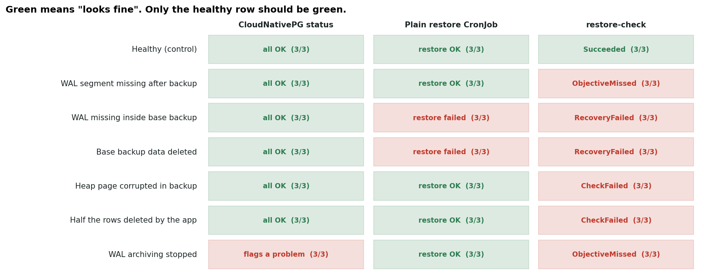

CloudNativePG `Backup completed` tells you the base backup was uploaded. To know whether it's restorable, we deployed a CronJob to automate restore tests on a schedule so we could get alerted upon failure. An independent due diligence we did ourselves caught a failed restore that our CronJob missed alerting us about, so I built a Kubernetes controller for CNPG that runs restore checks on a schedule, tests the restore and verifies the data.

I conducted a benchmark study on restore reliability by breaking backups on purpose, six different ways, and asked three things whether I could still restore:

1. **CloudNativePG's own status**: the `Backup` phase and the cluster's `ContinuousArchiving` condition.
2. **A plain restore CronJob**: create a recovery cluster from the latest backup, wait for it to become Ready, delete it. This is the restore test many teams write first.
3. **[restore-check](https://github.com/shanurwan/cnpg-restore-check)**, the Kubernetes operator I wrote for this: it restores into a temporary cluster, then runs amcheck over every page, a SQL check you choose, and a check on how old the newest restored data is.

Each scenario ran three times on a fresh namespace, a fresh bucket prefix and a fresh source cluster. Everything (scripts, raw results, charts) is in the repo's [benchmark folder](https://github.com/shanurwan/cnpg-restore-check/tree/main/benchmark).

## The result

| | Broken backups caught (of 6) |
|---|---|
| CloudNativePG status | 1 |
| Plain restore CronJob | 2 |
| restore-check | 6 |

In five of the six cases CloudNativePG reported every backup `completed` and archiving healthy. That is not a bug in CloudNativePG. Its status describes the upload, and the upload was fine. What happened to the files afterwards, or what was in them, is outside what it can see. The plain CronJob is the more interesting column, because it is what people build when they already know status is not enough.

## What "it restored" misses

The CronJob failed only when the restore could not start at all: when the base backup's data was gone, or when the first WAL segment the backup needs was deleted. It passed the other four.

**A WAL segment missing after the backup.** I expected this one to fail. It does not. Recovery replays WAL up to the gap, stops, and the cluster comes up Ready. Everything written after the gap is simply not there. A restore test that waits for Ready reports success. restore-check reported `ObjectiveMissed`: the newest restored row was 1m42s old against a 60-second objective.

**A corrupted page.** I overwrote 64 bytes on one page of a table inside the backup's `data.tar`. Postgres started fine, because it does not read every page on startup. amcheck found it: `invalid page in block 3 of relation base/16385/16392`.

**Half the rows deleted by the application before the backup.** The backup is perfect. The data was already wrong. No restore test catches this unless it knows what the data should look like. In the benchmark that is a `count(*)`; in production it would be a query about something you know must be true.

**Archiving stopped.** I replaced the archive credentials with wrong ones. CloudNativePG noticed (`ContinuousArchiving=False`) and restore-check reported the restored data 8 minutes stale. The CronJob restored the last backup and the WAL that made it out, and passed.

## Three things I did not expect

### 1. WAL replay can repair the corruption you injected

My first version of the corruption test passed every check. The corrupted page was clean after the restore.

The reason: autovacuum touched the table after the backup started. The first change to a page after a checkpoint writes a full image of that page into WAL, and recovery wrote that clean image over my damaged copy. Once I ran `VACUUM (FREEZE)` and `CHECKPOINT` before the backup, the damage survived recovery and amcheck caught it.

So: corruption in a base backup only hurts you on pages that nothing rewrote afterwards. Unfortunately those are exactly the cold, rarely touched pages nobody looks at.

### 2. A failing restore takes a long time to say so

| Failure | restore-check verdict (median) | Plain CronJob |
|---|---|---|
| Base backup data deleted | 11.7 min | 20 min (its own timeout) |
| WAL missing inside the base backup | 11.4 min | 20 min |
| Everything else | 1.4 to 2.7 min | (passed) |

When the restore cannot work, CloudNativePG retries the recovery job several times before giving up. restore-check reports as soon as the job is marked failed. A CronJob that waits for Ready has no such signal; it waits for its timeout. If your restore test has a generous timeout, a broken backup costs you the full timeout every run.

### 3. Restore time is counted in WAL segments, not gigabytes

I ran 30 restores back to back from one base backup while a small writer kept going. Restore time climbed from 75 seconds to almost 15 minutes. It looked like a leak. It was WAL: every run had more segments to replay.

Each 16 MiB segment added about a second to the restore, whether it was full of changes from pgbench (1.31 s) or nearly empty because of a forced switch (0.96 s). Recovery fetches segments one at a time, and the per-segment cost dominates.

This matters because of `archive_timeout`. CloudNativePG sets it to 5 minutes, so a database with a small, steady trickle of writes closes up to 288 segments a day. That is roughly five minutes of restore time for every day since the last base backup, before you count any real data. Base backup frequency sets the ceiling on how long a restore takes, not just how much you store.

(The object store in this benchmark was in the same cluster, so absolute times are low. With S3 over a network each fetch costs more. plugin-barman-cloud can fetch WAL in parallel; I used the default and did not measure that.)

## What I would check in your own setup

- **Do you restore at all, on a schedule?** Status will not tell you.
- **Does your restore test look at the data?** Ready is not enough. At least: amcheck, one query about something that must be true, and how old the newest row is.
- **How old is your newest base backup, and how many WAL segments are behind it?** That number is your restore time.
- **How long does your test take to fail?** If the answer is "its timeout", you will learn about a broken backup late.
- **If you write your own restore CronJob, do not give its ServiceAccount the same name as the recovery cluster.** CloudNativePG creates a ServiceAccount and Role named after each cluster, and mine was silently replaced. My job lost permission to delete the cluster it had just created.

## How I tried to keep myself honest

Every fault records proof that it was applied: the deleted object key and a `HEAD` showing it is gone, the checksum of the tar member before and after corruption, the number of rows deleted. That proof caught my own mistakes:

- The first "WAL missing inside the base backup" fault deleted the `.backup` label file instead of the WAL segment, because the names share a prefix. The restore passed, the recorded key showed why, and I reran the scenario with an exact match.
- The unfrozen corruption test above.
- I never cleaned up the bucket between runs. The disk filled, Kubernetes evicted the object store, and a batch of runs failed. Those runs were thrown away and rerun.

93 runs in total, about ten hours on one machine. None of them left a cluster, job, pod or volume behind.

## Limits

One node, small databases (1 to 4.4 GB), an object store in the same cluster, and faults I injected rather than found. The CronJob is one reasonable script, not every possible one; add SQL checks to it and it catches more. By then you are writing your own restore-check.

The full method, every table and the scripts to reproduce it are in [BENCHMARK.md](https://github.com/shanurwan/cnpg-restore-check/blob/main/benchmark/BENCHMARK.md). If you run it on real infrastructure, I would like to see your numbers.
